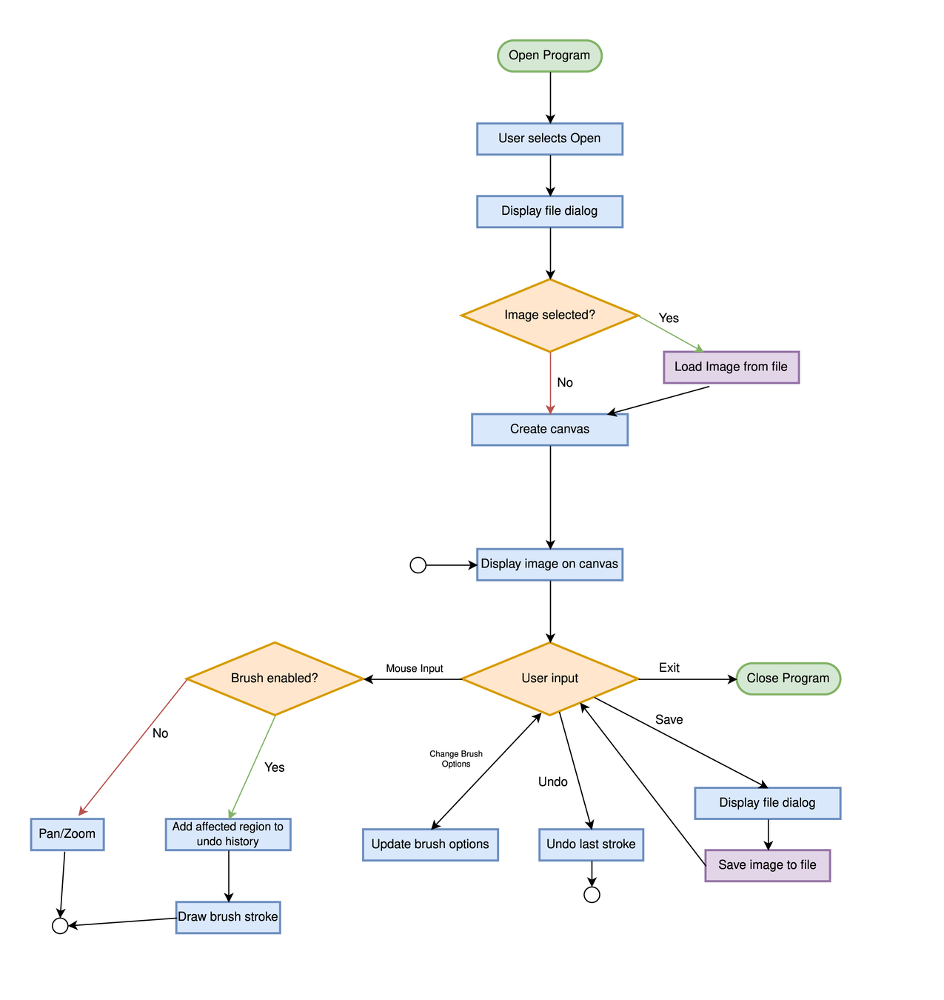

# PicoPhoto

A simple, lightweight image editor focused on essential image editing tools.

## The Problem

Image editing programs, especially on Linux, tend to be clunky. Advanced programs such as GIMP and Krita offer many features beyond what I need, making them feel bloated. Meanwhile, lighter-weight alternatives often have poor user interfaces.

This project aims to provide a simpler alternative with only the essential image editing features.

## How It Works

PicoPhoto will allow users to open an image, make basic edits using a brush tool, and save the edited image.

The initial version will support:
- Loading and saving JPG and PNG images.
- Displaying images on a canvas.
- Panning and zooming.
- Drawing with a brush tool.
- Undoing the most recent brush stroke.

## Tech Stack

- **Language:** C++
- **Libraries:** Qt
- **Build System:** CMake

## Setup

Setup instructions will be added once the application has been implemented.

## Usage

Usage instructions will be added once the application has been implemented.

## Roadmap

Planned features for future versions:

- [ ] Image cropping and resizing.
- [ ] Shape tools.
- [ ] Selection tools.
- [ ] Text tools.
- [ ] Layers.
- [ ] Support for multiple open images.

## Author

Yousef Alkhalawi ([7yu7](https://github.com/7yu7))